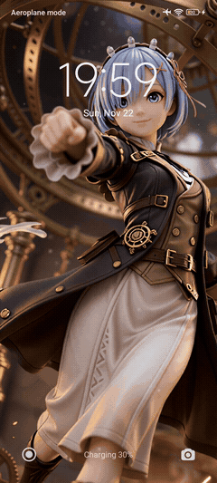
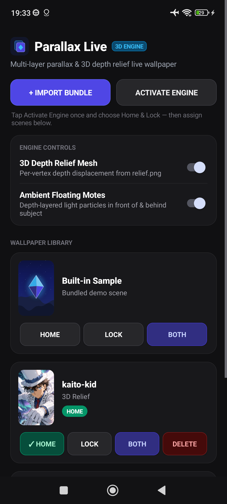
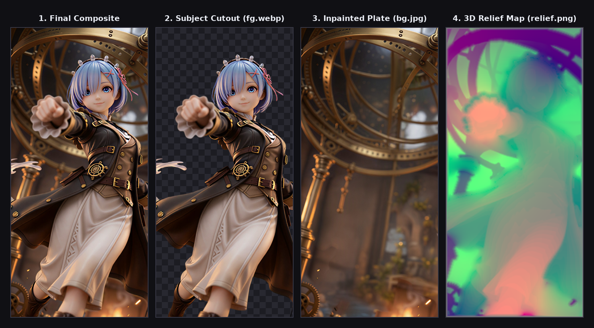

# Parallax Live — Layered 3D Parallax Wallpaper Engine for Android

A tiny, zero-Gradle, zero-permission Android `WallpaperService` that turns layered AI art (background plate + foreground cutout + optional depth relief map) into smooth, tilt-reactive 3D parallax live wallpapers — without the edge stretching, halos, or disocclusion tears you get from single-image depth-map warps.

> Full walkthrough & sample bundle download: **[From AI Art to 3D Parallax Live Wallpapers on Android (Civitai Article)](https://civitai.com/articles/39506/from-ai-art-to-3d-parallax-live-wallpapers-on-android-without-the-stretched-edges-and-halos)**

<p align="center">
  
  &nbsp;&nbsp;&nbsp;
  
</p>

## Why layered + relief instead of a single depth map?

When you warp a single image with a depth map (MiDaS / Depth Anything), tilting the phone reveals areas behind the subject that don't exist in the image — producing rubbery stretched edges and dark halos around hair and silhouettes.

<p align="center">
  
</p>

**Parallax Live** splits the scene into two clean planes and applies a smooth, border-zeroed per-vertex relief mesh (`61 × 135`) on top:

- **Far plane (`bg.jpg` or `bg.png`)**: clean inpainted background with no subject.
- **Near plane (`fg.webp` or `fg.png`)**: RGBA subject cutout.
- **3D Relief (`relief.png`, optional)**: 2-channel depth relief (`R` = foreground, `G` = background, centered at `128`, tapered back to `128` at the borders so the mesh never folds).
- **Wind sway (`sway.png` + `swing.png`, optional)**: localized hair/cloth sway mask.
- **Depth-layered motes**: ambient light particles drifting both *behind* and *in front of* the subject.

## Highlights

- **Transparent & auditable**: 2 pure-Java files (`~1,680` LOC), zero third-party libraries, zero Gradle wrapper binaries (~184 KB APK).
- **Android 10+** (API 29), compiled against target SDK 35, tested on Android 13 (Redmi Note 10 Pro) and HyperOS 3.
- **Zero permissions**: doesn't even request `INTERNET`.
- **Low idle footprint**: caps at ~30 fps only while visible; unregisters sensors and stops rendering immediately when hidden or screen is off.
- **Home + Lock slots**: assign different scenes to Home and Lock screens.
- **On-device `.wpbundle` import**: open any `.wpbundle` / `.zip` via **+ Import Bundle** or your file manager.

---

## Building the APK yourself

### Prerequisites

- **Android SDK** (`build-tools` + `platforms/android-35` or newer), with `ANDROID_SDK_ROOT` set (or installed in `~/Android/Sdk`)
- **JDK 11+** (`javac` + `keytool` in `PATH` or `JAVA_HOME`)
- **Python 3 + Pillow 9.1+ with WebP support** (`pip install pillow`) — used only to generate the built-in procedural sample scene and pack custom `.wpbundle` files

### Build

```bash
chmod +x build.sh
./build.sh
```

This compiles `src/dev/parallaxlive/*.java` directly with `aapt2` + `javac` + `d8` + `zipalign` + `apksigner` and writes:

```text
out/parallax-live.apk
```

Install via ADB or copy to your phone:

```bash
adb install -r out/parallax-live.apk
```

To bake your own scenes into the APK instead of the procedural sample, pass unpacked bundle folders (a folder with `bg.jpg`, `fg.webp`, ...):

```bash
./build.sh out my_home_scene_dir [my_lock_scene_dir]
```

> **Release signing:** By default, `build.sh` signs with a local debug keystore for personal sideloading. To sign with your own keystore:
> ```bash
> KEYSTORE=/path/to/release.jks KEYSTORE_PASS=... KEY_ALIAS=... ./build.sh
> ```
> If the key password differs from the keystore password, also set `KEY_PASSWORD`.

---

## Creating your own `.wpbundle` from AI art (ComfyUI / any generator)

1. Generate a portrait wallpaper (e.g. `9:20` aspect ratio).
2. Remove the background to get **`fg.png`** (RGBA cutout).
3. Inpaint the removed subject area on the original image to get a clean **`bg.png`** (or `bg.jpg`).
4. *(Optional)* Run **Depth Anything V2 / V3** on the original image to get a grayscale **`depth.png`** (bright = near, dark = far).
5. Pack into a `.wpbundle`:

```bash
python3 tools/pack_bundle.py \
  --bg bg.png \
  --fg fg.png \
  --depth depth.png \
  --title "My Scene" \
  --tint "186,230,253" \
  --out my_scene.wpbundle
```

Images larger than 3200 px on the longest side are downscaled (`--max-side N` changes the limit, `0` disables it). `--sway` and `--swing` accept the optional wind maps described below; they must have the same dimensions.

Transfer `my_scene.wpbundle` to your phone, open **Parallax Live**, tap **+ Import Bundle**, and assign it to Home, Lock, or Both.

### `.wpbundle` archive format

A `.wpbundle` is a standard `.zip` containing flat files:

| File | Required | Format |
| --- | --- | --- |
| `bg.jpg` or `bg.png` | Yes | Clean background plate |
| `fg.webp` or `fg.png` | Yes | Subject cutout with alpha |
| `relief.png` | No | RGB PNG: `R` = fg relief, `G` = bg relief (`128` = neutral, range `0..255`, tapered to `128` at edges) |
| `sway.png` | No | Grayscale wind looseness mask (`0` = rigid, `255` = loose hair/cloth) |
| `swing.png` | No | RGB wind vector & phase lag (`R` = Qxx, `G` = Qxy, `B` = lag) |
| `thumb.png` | No | Preview thumbnail for the in-app library |
| `meta.json` | No | `{"character": "...", "style": "...", "tint": [R, G, B], "relief": true}` |

## Known limitations

- **Portrait orientation**: accelerometer tilt axes assume portrait orientation (landscape orientation is not remapped).
- **After reboot**: like most third-party live wallpapers, imported scenes become available after the first unlock following a reboot.
- **Wind maps**: `tools/pack_bundle.py` generates `relief.png` from a grayscale depth map, while optional `sway.png` / `swing.png` wind maps must be prepared separately.

## License

MIT — see [LICENSE](LICENSE).
